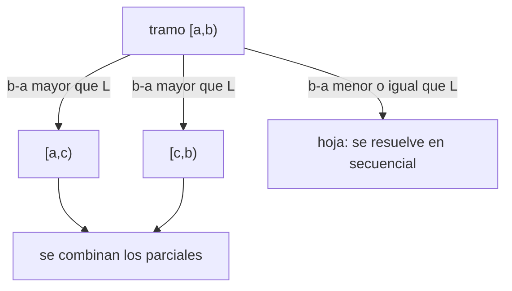

# Informe de corrección — Taller 4

Aquí argumento que cada función hace lo que pide el enunciado. Me concentro en
lo que se pide en concreto: que partir el sistema en tramos **no pierde ni
repite** partículas, que la operación con que se combinan los resultados
parciales es **asociativa**, y que la versión paralela da el **mismo resultado**
que la secuencial. También explico por qué la suma se puede repartir y el
promedio no.

## Notación

- El sistema es $s = [x_0, x_1, \dots, x_{n-1}]$, con $n$ partículas.
- De cada partícula $p$ me interesan su posición $r(p)$, su velocidad $v(p)$ y su
  masa $m(p)$.
- El tramo $[a, b)$ es el conjunto de índices $\{a, a+1, \dots, b-1\}$, con
  $0 \leq a \leq b \leq n$. Tiene $b - a$ elementos. El tramo $[a, a)$ es vacío.
- `s.slice(a, b)` es el arreglo $[x_a, \dots, x_{b-1}]$.
- $L = \max(\text{umbral}, 1)$ es el límite que usa el código.
- $u \mathbin{++} w$ es pegar dos arreglos y $\varepsilon$ es el arreglo vacío.

## 1. Partir el sistema no pierde ni repite partículas

Las tres funciones repartidas (`pasoParalelo`, `energiaParalela` y
`centroDeMasaParalelo`) parten un tramo $[a, b)$ con la misma regla:

- Si $b - a \leq L$, el tramo es una **hoja** y se resuelve en secuencial.
- Si $b - a > L$, se toma $c = a + \lfloor (b - a)/2 \rfloor$ y se resuelven
  $[a, c)$ y $[c, b)$.

### Lema 1: las dos mitades son menores

Si $b - a > L \geq 1$, entonces $b - a \geq 2$, y por eso

$$a < c < b$$

Los tamaños de las mitades son $c - a = \lfloor (b-a)/2 \rfloor$ y
$b - c = \lceil (b-a)/2 \rceil$. Para $b - a \geq 2$ ambos son estrictamente
menores que $b - a$. Entonces cada llamado recursivo trabaja sobre un tramo más
pequeño, y la recursión **termina**. El límite $L \geq 1$ garantiza que un tramo
de un solo elemento nunca se parte.

### Lema 2: las hojas son una partición del tramo

**Afirmación.** Las hojas que se obtienen al partir $[a, b)$ son tramos
disjuntos dos a dos, cuya unión es $[a, b)$, y quedan ordenados de izquierda a
derecha. Es decir, cada índice $i$ con $a \leq i < b$ pertenece a **exactamente
una** hoja.

*Demostración, por inducción fuerte sobre $b - a$.*

- **Caso base**, $b - a \leq L$: la única hoja es $[a, b)$ y la afirmación es
  evidente.
- **Paso**, $b - a > L$: por el lema 1, $[a, c)$ y $[c, b)$ son tramos más
  pequeños. Son disjuntos porque ningún índice es a la vez menor que $c$ y
  mayor o igual que $c$, y su unión es $[a, b)$. Por hipótesis de inducción, cada
  uno se parte en hojas que lo cubren sin solaparse. Las hojas de $[a, c)$ van
  antes que las de $[c, b)$. Por tanto la afirmación vale para $[a, b)$.
  $\blacksquare$

**Consecuencia:** al partir el sistema completo $[0, n)$, **ninguna partícula se
pierde y ninguna se repite**, y se conserva el orden. Con $n = 0$ el tramo es
vacío y no hay nada que repartir.

## 2. Punto 1: un paso de la simulación

`mover(p, dt)` devuelve la partícula con posición $r(p) + dt \cdot v(p)$ y con la
misma velocidad y masa. `pasoSegmento(s, dt, a, b)` aplica `mover` a cada
partícula del tramo:

$$\text{pasoSegmento}(s, dt, a, b) = [\,\text{mover}(x_i, dt) : a \leq i < b\,]$$

y `pasoSecuencial(s, dt)` es `pasoSegmento(s, dt, 0, n)`.

**Teorema 1.** Para todo sistema $s$, todo $dt$ y todo umbral:

$$\text{pasoParalelo}(s, dt, \text{umbral}) = \text{pasoSecuencial}(s, dt)$$

*Demostración.* Sea $\text{aux}(a, b)$ la función auxiliar de `pasoParalelo`.
Muestro por inducción fuerte sobre $b - a$ que

$$\text{aux}(a, b) = [\,\text{mover}(x_i, dt) : a \leq i < b\,]$$

- **Caso base**, $b - a \leq L$: `aux` llama a `pasoSegmento` sobre el tramo, que
  es exactamente la expresión de arriba.
- **Paso**, $b - a > L$: `aux(a, b)` es `aux(a, c) ++ aux(c, b)`. Por hipótesis de
  inducción es

$$[\,\text{mover}(x_i, dt) : a \leq i < c\,] \mathbin{++} [\,\text{mover}(x_i, dt) : c \leq i < b\,]$$

que es la lista de $\text{mover}(x_i, dt)$ para $a \leq i < b$, en orden.

Con $a = 0$ y $b = n$ se obtiene `pasoSecuencial`. $\blacksquare$

**Dos observaciones.**

1. **El resultado no depende del umbral:** la demostración vale para cualquier
   $L \geq 1$. Además es una **igualdad exacta**, no aproximada, porque cada
   partícula nueva se calcula con la misma expresión, sin importar cómo se
   partió el sistema. No se suma nada entre partículas distintas.
2. **La operación que combina es la concatenación `++`**, que es asociativa:

$$(u \mathbin{++} w) \mathbin{++} z = u \mathbin{++} (w \mathbin{++} z)$$

y tiene a $\varepsilon$ como elemento neutro. Por eso el resultado no cambia
según cómo se agrupen las mitades.

## 3. Punto 2: magnitudes globales

Las tres funciones secuenciales coinciden con las definiciones del enunciado:

$$E(s) = \sum_{i=0}^{n-1} \tfrac{1}{2}\, m(x_i)\, \lVert v(x_i) \rVert^2 \qquad
M(s) = \sum_{i=0}^{n-1} m(x_i)$$

$$C(s) = \begin{cases}
\dfrac{1}{M(s)} \displaystyle\sum_{i=0}^{n-1} m(x_i)\, r(x_i) & \text{si } M(s) \neq 0 \\[2ex]
(0, 0) & \text{si } M(s) = 0
\end{cases}$$

En el código, `norma * norma` es $\lVert v \rVert^2$. Con el sistema vacío, todas
las sumas son sumas vacías y valen $0$, y $C = (0, 0)$.

Comprobación con el ejemplo del enunciado (`P1`: $r = (0,0)$, $v = (3,4)$,
$m = 2$; `P2`: $r = (4,0)$, $v = (0,0)$, $m = 2$):

$$E = \tfrac{1}{2} \cdot 2 \cdot 5^2 + 0 = 25 \qquad M = 4 \qquad
C = \frac{2 \cdot (0,0) + 2 \cdot (4,0)}{4} = (2, 0)$$

## 4. Punto 3: las versiones repartidas

### La estructura que permite repartir

Para un tramo $T$ defino los valores parciales:

$$e(T) = \sum_{p \in T} \tfrac{1}{2}\, m(p)\, \lVert v(p) \rVert^2 \qquad
W(T) = \sum_{p \in T} m(p)\, r(p) \qquad
\mu(T) = \sum_{p \in T} m(p)$$

Cada uno es una **suma sobre los elementos del tramo**. Por el lema 2, los
tramos hoja son una partición del sistema, así que cada partícula se suma
**una sola vez**. Por tanto:

$$E(s) = \sum_{\text{hojas } T} e(T) \qquad
W(s) = \sum_{\text{hojas } T} W(T) \qquad
M(s) = \sum_{\text{hojas } T} \mu(T)$$

### La operación de combinación es asociativa

- En la energía se combinan dos números con $+$.
- En el centro de masa se combinan parejas $(W, \mu)$ con

$$(W_1, \mu_1) \oplus (W_2, \mu_2) = (W_1 + W_2,\ \mu_1 + \mu_2)$$

**Afirmación.** $\oplus$ es asociativa, conmutativa y tiene elemento neutro
$((0,0), 0)$.

*Demostración.* Opera coordenada a coordenada con la suma de números reales, que
es asociativa y conmutativa:

$$\big((W_1, \mu_1) \oplus (W_2, \mu_2)\big) \oplus (W_3, \mu_3) = (W_1 + W_2 + W_3,\ \mu_1 + \mu_2 + \mu_3) = (W_1, \mu_1) \oplus \big((W_2, \mu_2) \oplus (W_3, \mu_3)\big)$$

$\blacksquare$

Por eso da igual **cómo se agrupen** las mitades: el reparto no cambia el
resultado.

### Teorema 2

Para todo sistema y todo umbral:

$$\text{energiaParalela}(s, \text{umbral}) = E(s) \qquad
\text{centroDeMasaParalelo}(s, \text{umbral}) = C(s)$$

*Demostración.* Por inducción sobre el tramo, igual que en el teorema 1: cada
`aux(a, b)` devuelve $e([a, b))$ en la energía y $(W([a, b)), \mu([a, b)))$ en el
centro de masa. En el caso base lo calcula la versión secuencial sobre
`s.slice(a, b)`. En el paso, devuelve $e([a,c)) + e([c,b))$, o la pareja
$(W([a,c)), \mu([a,c))) \oplus (W([c,b)), \mu([c,b)))$, que son $e([a,b))$ y
$(W([a,b)), \mu([a,b)))$ porque $[a,c)$ y $[c,b)$ son una partición de $[a,b)$.
Con $a = 0$ y $b = n$ se obtienen $E(s)$ y $(W(s), M(s))$. Al final, el código
divide **una sola vez**: $C = W(s) / M(s)$ si $M(s) \neq 0$ y el origen si
$M(s) = 0$. $\blacksquare$

### Por qué la suma sirve para repartir y el promedio no

El promedio de un tramo es $\bar r(T) = W(T)/\mu(T)$. El promedio del tramo
completo, en función de los de las mitades, es

$$\bar r(T_1 \cup T_2) = \frac{\mu(T_1)\, \bar r(T_1) + \mu(T_2)\, \bar r(T_2)}{\mu(T_1) + \mu(T_2)}$$

es decir, un promedio **ponderado por las masas**. Si se descartan las masas y
solo se llevan los promedios, la información que falta no se puede recuperar.

**Contraejemplo.** Tres partículas de masa 1 en las posiciones $1, 2, 3$:

| Forma de calcular | Cuenta | Resultado |
|---|---|---|
| Directa | $(1 + 2 + 3)/3$ | $2$ |
| Promedio de los promedios de $[1]$ y $[2, 3]$ | $(1 + 2.5)/2$ | $1.75$ |
| Suma y masa de cada mitad | $(1 + 5)/(1 + 2)$ | $2$ |

Además, el promedio simple **ni siquiera es asociativo**. Con $a = 0$, $b = 0$,
$c = 4$:

$$\frac{\frac{a+b}{2} + c}{2} = 2 \qquad \text{y} \qquad \frac{a + \frac{b+c}{2}}{2} = 1$$

Si la combinación no es asociativa, el resultado depende de cómo se parta el
sistema, o sea del umbral. La suma sí es asociativa, y por eso se lleva la suma
ponderada y la masa, y se divide una sola vez al final.

### Aritmética de punto flotante

Con números reales la suma es asociativa. Con `Double` no lo es exactamente:
$(a + b) + c$ puede diferir de $a + (b + c)$ en los últimos dígitos, porque cada
suma redondea. Como el reparto agrupa las sumas de otra forma, la versión
paralela y la secuencial pueden diferir en unas pocas unidades del último
dígito. Por eso las pruebas comparan la energía y el centro de masa con una
tolerancia pequeña, y no con igualdad exacta. En el punto 1 la igualdad sí es
exacta, porque no se suma entre partículas.

## 5. Punto 4: trabajo y profundidad

Sea $D(m)$ la profundidad de un tramo de $m$ elementos con límite $L$. El
código define:

$$D(m) = \begin{cases}
m & \text{si } m \leq L \\
1 + D(\lceil m/2 \rceil) & \text{si } m > L
\end{cases}$$

Se sigue el tramo **mayor** de cada partición, que tiene $\lceil m/2 \rceil$
elementos, porque es el que determina cuánto tarda el reparto. Por el lema 1,
$\lceil m/2 \rceil < m$ cuando $m \geq 2$, así que la recursión termina. El
trabajo es $T(n) = n$: por el lema 2 las hojas suman $n$ elementos, y repartir no
cambia ese total.

**Fórmula para potencias de dos.** Si $n = 2^k$ y $L = 2^j$ con $j \leq k$:

$$D(2^k) = (k - j) + 2^j$$

*Demostración, por inducción sobre $k - j$.* Si $k = j$, entonces $2^k \leq L$ y
$D = 2^k = 0 + 2^j$. Si $k > j$, entonces $D(2^k) = 1 + D(2^{k-1}) = 1 + (k - 1 - j) + 2^j = (k - j) + 2^j$.
$\blacksquare$

Con ella se verifican los ejemplos del enunciado:

| $n$ | $L$ | $k - j$ | $D$ |
|---|---|---|---|
| $1024 = 2^{10}$ | $1024 = 2^{10}$ | $0$ | $0 + 1024 = 1024$ |
| $1024 = 2^{10}$ | $512 = 2^{9}$ | $1$ | $1 + 512 = 513$ |
| $1024 = 2^{10}$ | $1 = 2^{0}$ | $10$ | $10 + 1 = 11$ |

El tiempo estimado es $D(n) + n/p$. Para $n = 1024$, $p = 4$ y $L = 1$:
$11 + 1024/4 = 267$.

## 6. Punto 5: aceleración y umbral conveniente

La aceleración es $S = t_{\text{sec}} / t_{\text{par}}$. Dos observaciones sobre
la corrección:

1. **La fila de control es exacta.** Con umbral igual a $n$ se cumple
   $n \leq L$, así que `aux(0, n)` es una sola hoja y `pasoParalelo` es
   `pasoSegmento(s, dt, 0, n)`, o sea `pasoSecuencial`. Las dos versiones ejecutan
   **la misma computación**: la aceleración tiene que dar $1$, salvo el ruido de
   la medición.
2. **`umbralConveniente`** devuelve un elemento de la lista que minimiza el tiempo
   medido, y con la lista vacía devuelve $n$, que equivale a no repartir. Mide
   tiempos, y por eso las pruebas no lo ejercitan más que con la lista vacía.

## Resumen

| Función | Qué se demuestra | Resultado |
|---|---|---|
| `pasoParalelo` | Lema 2 y teorema 1 | Igual a `pasoSecuencial`, exacto |
| `energiaParalela` | Lema 2, $+$ asociativa y teorema 2 | Igual a la secuencial, salvo punto flotante |
| `centroDeMasaParalelo` | Lema 2, $\oplus$ asociativa y teorema 2 | Igual a la secuencial, salvo punto flotante |
| `profundidad` | Recurrencia y fórmula para potencias de dos | Coincide con los ejemplos |
| `aceleracion` con umbral $n$ | No se reparte nada | Vale $1$ |