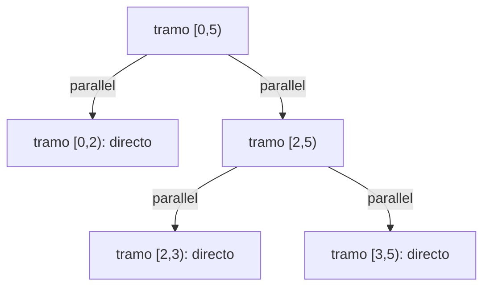

# Informe de proceso — Taller 4

En este informe explico cómo se ejecuta cada función paso a paso, qué tramo
resuelve cada llamado en las versiones repartidas y cómo se combinan los
resultados parciales.

## Cómo se reparte el trabajo

Las funciones repartidas (`pasoParalelo`, `energiaParalela` y
`centroDeMasaParalelo`) usan todas la misma idea:

1. Se trabaja sobre un **tramo** `[desde, hasta)` del arreglo. `desde` está
   incluido y `hasta` está excluido.
2. Si el tramo tiene **a lo sumo `umbral` elementos**, se resuelve en
   secuencial.
3. Si tiene más, se calcula `mitad = desde + (hasta - desde) / 2` y se
   resuelven `[desde, mitad)` y `[mitad, hasta)` **al mismo tiempo** con
   `parallel`.
4. Cuando las dos mitades terminan, sus resultados se **combinan**.

`parallel(a, b)` calcula `a` y `b` a la vez y devuelve la pareja de resultados.
En todas las versiones repartidas uso `limite = math.max(umbral, 1)`, para que un
umbral de cero o negativo no haga que la recursión no termine.

## Punto 1: un paso de la simulación

### `mover`

Mueve **una** partícula: la posición nueva es `pos + vel * dt`, y la velocidad
y la masa se copian sin cambio. Todas las versiones del paso usan esta misma
función, así que hacen exactamente el mismo trabajo por partícula.

Ejemplo con `p = Particula(Vector2(0, 0), Vector2(1, 2), 1.0)` y `dt = 2.0`:

| Paso | Cálculo | Resultado |
|---|---|---|
| 1 | `vel * dt` = `(1, 2) * 2.0` | `(2.0, 4.0)` |
| 2 | `pos + (2.0, 4.0)` = `(0, 0) + (2.0, 4.0)` | `(2.0, 4.0)` |

La partícula nueva tiene posición `(2.0, 4.0)`, velocidad `(1, 2)` y masa `1.0`.

### `pasoSegmento` y `pasoSecuencial`

`pasoSegmento(s, dt, desde, hasta)` toma el tramo con `s.slice(desde, hasta)`
y le aplica `mover` a cada partícula. Devuelve un arreglo nuevo: nunca
modifica el original. `pasoSecuencial` es `pasoSegmento` sobre todo el sistema,
de `0` a `s.length`.

Ejemplo con cinco partículas `A, B, C, D, E` en las posiciones `x = 0, 1, 2, 3, 4`
(`y = 0`), todas con velocidad `(1, 0)`, y `dt = 1.0`:

| Llamado | Tramo | Partículas movidas | Posiciones nuevas en `x` |
|---|---|---|---|
| `pasoSecuencial(S, 1.0)` | `[0, 5)` | `A, B, C, D, E` | `1, 2, 3, 4, 5` |
| `pasoSegmento(S, 1.0, 1, 4)` | `[1, 4)` | `B, C, D` | `2, 3, 4` |
| `pasoSegmento(S, 1.0, 2, 2)` | `[2, 2)` | ninguna | arreglo vacío |

### `pasoParalelo`

Con el mismo sistema de cinco partículas y `umbral = 2`:

| Llamado | Tramo | Tamaño | Qué hace |
|---|---|---|---|
| `aux(0, 5)` | `[0, 5)` | 5 | Supera 2: `mitad = 2`, resuelve `[0, 2)` y `[2, 5)` a la vez |
| `aux(0, 2)` | `[0, 2)` | 2 | No supera 2: `pasoSegmento` directo |
| `aux(2, 5)` | `[2, 5)` | 3 | Supera 2: `mitad = 3`, resuelve `[2, 3)` y `[3, 5)` a la vez |
| `aux(2, 3)` | `[2, 3)` | 1 | `pasoSegmento` directo |
| `aux(3, 5)` | `[3, 5)` | 2 | `pasoSegmento` directo |

**Cómo se combinan los resultados:** con `izquierda ++ derecha`, que pega los
arreglos conservando el orden.

| Combinación | Resultado en `x` |
|---|---|
| `[2,3) ++ [3,5)` | `3, 4, 5` |
| `[0,2) ++ (3, 4, 5)` | `1, 2, 3, 4, 5` |

Es el mismo resultado de `pasoSecuencial`. Las hojas `[0,2)`, `[2,3)` y
`[3,5)` no se solapan y juntas cubren las cinco partículas: ninguna se pierde
ni se repite.

Con el sistema vacío, `hasta - desde` vale 0, no supera el límite y
`pasoSegmento` devuelve un arreglo vacío.

## Punto 2: magnitudes globales en secuencial

### `energiaSecuencial`

Suma `0.5 * masa * norma(vel)^2` de cada partícula, con `map` y `sum`.

Ejemplo del enunciado: `P1` con velocidad `(3, 4)` y masa 2, y `P2` quieta con
masa 2.

| Partícula | Norma de la velocidad | `0.5 * masa * norma * norma` |
|---|---|---|
| `P1` | 5 | `0.5 * 2 * 5 * 5 = 25.0` |
| `P2` | 0 | `0.0` |

Suma: `25.0`. Con el sistema vacío la suma es `0.0`.

### `masaTotal`

Suma las masas: `2.0 + 2.0 = 4.0`.

### `centroDeMasaSecuencial`

1. Calcula la masa total. Si es cero, devuelve el origen `(0, 0)`.
2. Con `foldLeft` va sumando `posición * masa` de cada partícula, partiendo de
   `(0, 0)`.
3. Divide cada coordenada entre la masa total, **una sola vez**.

| Partícula | `posición * masa` | Suma acumulada |
|---|---|---|
| `P1` | `(0, 0) * 2 = (0, 0)` | `(0, 0)` |
| `P2` | `(4, 0) * 2 = (8, 0)` | `(8, 0)` |

Se divide entre la masa total 4: `(8/4, 0/4) = (2.0, 0.0)`.

## Punto 3: las mismas magnitudes en paralelo

### `energiaParalela`

Cada tramo devuelve su energía y las dos mitades se **suman**. Ejemplo con
cuatro partículas cuyas energías son 1, 2, 3 y 4, y `umbral = 1`:

| Llamado | Tramo | Qué hace | Resultado |
|---|---|---|---|
| `aux(0, 4)` | `[0, 4)` | Parte en `[0, 2)` y `[2, 4)` a la vez | `3 + 7 = 10` |
| `aux(0, 2)` | `[0, 2)` | Parte en `[0, 1)` y `[1, 2)` | `1 + 2 = 3` |
| `aux(2, 4)` | `[2, 4)` | Parte en `[2, 3)` y `[3, 4)` | `3 + 4 = 7` |
| `aux(0, 1)`, `aux(1, 2)`, `aux(2, 3)`, `aux(3, 4)` | un elemento | `energiaSecuencial` del tramo | `1`, `2`, `3`, `4` |

El caso base reutiliza `energiaSecuencial` sobre `s.slice(desde, hasta)`.

### `centroDeMasaParalelo`

Aquí no se pueden promediar los promedios de las mitades, porque cada mitad
puede pesar distinto. Cada tramo devuelve **dos cosas**: la suma de
`posición * masa` y la masa. Esos dos valores se suman por separado y se
divide **una sola vez al final**.

Ejemplo del enunciado con `umbral = 1`:

| Tramo | Suma de `posición * masa` | Masa |
|---|---|---|
| `[0, 1)` (`P1`) | `(0, 0)` | 2.0 |
| `[1, 2)` (`P2`) | `(8, 0)` | 2.0 |
| **Combinado** | `(0,0) + (8,0) = (8, 0)` | `2.0 + 2.0 = 4.0` |

Resultado: `(8/4, 0/4) = (2.0, 0.0)`.

Por qué no se puede promediar los promedios: con tres partículas de masa 1 en
las posiciones 1, 2 y 3:

| Forma de calcular | Cuenta | Resultado |
|---|---|---|
| Directa | `(1 + 2 + 3) / 3` | 2 |
| Promedio de los promedios de `[1]` y `[2, 3]` | `(1 + 2.5) / 2` | 1.75 (incorrecto) |
| Suma y masa de cada mitad | `(1 + 5) / (1 + 2)` | 2 (correcto) |

## Punto 4: trabajo y profundidad

Estas funciones estiman el costo **sin ejecutar nada**.

- `trabajo(n) = n`: una operación por partícula. No baja por repartir.
- `profundidad(n, umbral)`: la auxiliar `aux(m)` devuelve `m` si
  `m <= limite`, y si no devuelve `1 + aux((m + 1) / 2)`. Es decir, cuenta
  cuántas veces se parte a la mitad hasta no superar el umbral y suma el
  trabajo del tramo que queda. Para tamaños impares sigue el tramo mayor.
- `tiempoEstimado(n, p, umbral) = profundidad(n, umbral) + trabajo(n) / p`.

Traza de `profundidad(8, 1)`:

| Llamado | `m` | Qué hace |
|---|---|---|
| `aux(8)` | 8 | Supera 1: `1 + aux(4)` |
| `aux(4)` | 4 | Supera 1: `1 + aux(2)` |
| `aux(2)` | 2 | Supera 1: `1 + aux(1)` |
| `aux(1)` | 1 | No supera 1: devuelve 1 |

Resultado: `1 + 1 + 1 + 1 = 4`, tres particiones y un elemento.

Los ejemplos del enunciado:

| Llamado | Cálculo | Resultado |
|---|---|---|
| `profundidad(1024, 1024)` | No se parte | 1024 |
| `profundidad(1024, 512)` | Una partición y un tramo de 512 | 513 |
| `profundidad(1024, 1)` | Diez particiones y un elemento | 11 |
| `tiempoEstimado(1024, 4, 1)` | `11 + 1024 / 4` | 267.0 |

## Punto 5: aceleración y umbral conveniente

### `aceleracion`

Es el cociente `tSecuencial / tParalelo`. `aceleracion(100.0, 25.0)` da `4.0` y
`aceleracion(100.0, 100.0)` da `1.0`.

### `medir`

Viene escrita en el material: `medir(repeticiones)(cuerpo)` ejecuta el bloque
`cuerpo` con ScalaMeter (`withWarmer(new Warmer.Default) measure`), que primero
calienta la máquina virtual, repite la medición `repeticiones` veces y devuelve
la **mediana** de los tiempos, en milisegundos.

### `umbralConveniente`

1. Si la lista de umbrales está vacía, devuelve `s.length`, que equivale a no
   repartir.
2. Si no, con `minBy` mide `pasoParalelo(s, dt, u)` para cada umbral `u` con
   `medir(3)` y devuelve el umbral de menor tiempo.

Ejemplo **ilustrativo** (los tiempos son inventados, solo para mostrar el
mecanismo) con `umbrales = List(100, 10000, 1000000)`:

| Umbral | Tiempo medido (ejemplo) |
|---|---|
| 100 | 40 ms |
| 10000 | 25 ms |
| 1000000 | 30 ms |

`minBy` devuelve 10000, que tiene el menor tiempo. Los tiempos reales de este
taller están en `docs/paralelizacion.md`.